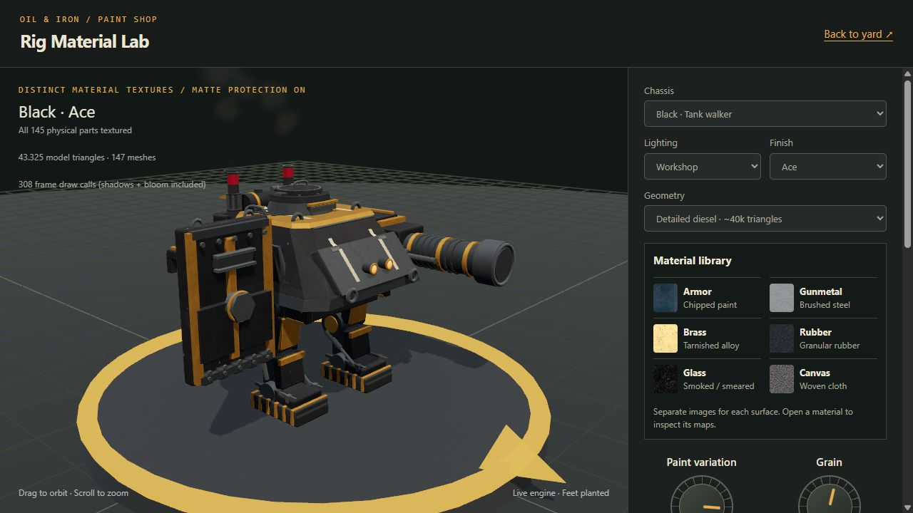
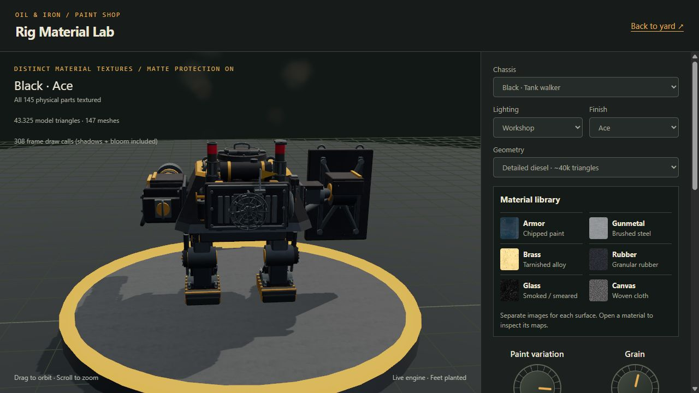

# Black detailed inspection POC

Recorded **2026-10-21**, following the [rig remodeling guide](rig-remodeling-guide.md). Black is `medium-shield-siege`, with Siege Maul and Bulwark Shield. Its vehicle ancestry is a heavy, sloped tank casemate with a low commander's cupola, distinct from Tyrian's truck cab.

This adds opt-in detailed geometry and the six-family material lab treatment. Standard battlefield geometry remains light. Weapon identity, muzzle position, base radius, damage locations and game rules are unchanged.



## Model and machinery

| Assembly | Detail added |
|---|---|
| Casemate | Smoother eligible edges, welded glacis seam, supported applique plates, deck grab handles, tow eyes, inspection ports and skirt hinges |
| Cupola | Rounded hatch, gasket, rim, hinge blocks, handle, fasteners and smoked-glass periscopes |
| Engine | Four circular service covers, curved injector lines, fuel rail, twin oil filters, connected hoses and static valve wheel |
| Cooling | Driven eight-blade fan, hub, fixed protective wire cage, mounting posts and radiator frame |
| Exhaust | Open stack mouths, inner liners and recessed floors, rims, slotted shields and clamps; repair collars remain open |
| Legs | Smoother bearing covers, bolt circles, grease fittings, four-layer leaf-spring packs and clamps |
| Siege Maul | Smoother barrel/receiver, bolted service plates, recoil hoses and collars, seven cooling rings, muzzle rim/recess and breech handle |
| Bulwark Shield | Rear carrier hub, vertical and diagonal braces, boss rim, reinforced vision slit, supported lifting eyes and replaceable lower teeth |

The cannon muzzle uses a rim and dark recess face, not a fully modeled internal bore. Valve wheels, hoses, springs and hatch hardware are static. The cooling fan follows the existing diesel phase; crank, piston, flywheel, rain flap and smoke retain their existing behavior. Shutdown, broken engine and destruction stop the fan with the rest of the engine.

Added parts live under the assembly that carries them. Shield hardware follows the shield group; suspension follows the ankle; engine fittings follow the engine. Fixed detail is merged only inside its moving parent and compatible material/damage grouping. The shield reference, stacks, hydraulic parts, mounted children and mapped decals are excluded from unsafe merges.



## Materials, skins and tuning

All five finishes work: Factory Fresh, Field Refit, Ace, Battle-Worn and Rust Bucket. All physical surfaces receive the existing separate image sets for armor, gunmetal, brass, rubber, glass and canvas. Sources, licenses, family values, projection and decal rules remain those in the [material section of the guide](rig-remodeling-guide.md#6-materials-separate-surfaces-separate-textures); no new texture downloads or dependencies were needed.

Anti-glare guards remain: roughness floor **0.70**, per-light peak cap **4**, study reflected-light cap **1.6**, bloom threshold **2.2**. Detail adds no lights. Smooth surface normals survive the material study and original-material comparison remains reversible.

Black retains its existing shake multipliers **magnitude 1 / frequency 1**. These were preserved, not newly approved in this pass. Tyrian keeps its approved **0.11 / 0.82**.

Material defaults remain **paint variation 0.85 / grain 0.55 / edge wear 0.35 / grime 0.30**. They are starting values, not a new user-approved recipe. The lab saves each chassis/skin independently; switching to Black cannot overwrite Tyrian's saved finish. JSON exports identify chassis, skin, geometry and all six texture sets.

## Measured cost

Browser model counts from the live material lab, including browser-generated marks:

| Black hero skin | Triangles | Meshes | Textured physical parts |
|---|---:|---:|---:|
| Factory Fresh | 42,638 | 121 | 119 |
| Field Refit | 43,784 | 141 | 139 |
| Ace | 43,325 | 147 | 145 |
| Battle-Worn | 43,607 | 145 | 144 |
| Rust Bucket | 44,120 | 149 | 147 |

Black Ace standard geometry measured **8,577 triangles / 132 meshes**, versus **43,325 / 147** for hero. Full-frame draws were **278 standard** and **302–308 hero** in the inspected Workshop views with smoke, shadows and bloom. These are observations, not a controlled timing benchmark; view and smoke change draw count. Tyrian Ace still measured **41,059 / 138** after shared helper extraction.

Headless checks enforce **35k–45k triangles / at most 160 meshes** across Black's detailed skins and standard geometry below 12k. Browser marks add small differences. Tiny cooling rings use economical tessellation to keep the most decorated skin inside budget.

No automatic LOD or populated-battle GPU benchmark was added. The detailed model and image-material pipeline remain an inspection POC, matching Tyrian's boundary. Profile real battles before promoting either into normal gameplay.

## Validation

- **147 3D tests passed**; direct Vite 3D build passed.
- New Black checks cover all-skin budgets, finite geometry, envelope, base/muzzle contracts, roughness floor, full shield assembly clearance through walking/aiming/bash, hydraulic anchors and engine stop/resume.
- Material coverage, smooth-normal preservation and reversible comparison now cover both detailed chassis across all five skins.
- Independent code review found no important or critical defect. The fan's measured swept radius is `0.232512` and depth `±0.033717`; fixed cage/support planes at `±0.075` clear it, excluding the intentional central shaft connection. Both stack mouths and skin collars stay open across the five skins.
- Browser inspection covered front, rear, weapon sides, elevated view, all five finishes and Workshop/Foundry Dusk/Glare Check. No reflected bloom washout appeared in inspected views.
- Four material controls, chassis isolation, reload persistence, original comparison, standard/hero switching and idle pause/resume worked. Browser console had no warnings/errors during the review.
- Exported self-contained HTML started and rendered Black Ace correctly when served through a temporary local HTTP preview. Its JS and texture assets are embedded; the temporary preview server is not a required part of the export.

## Open and reproduce

- [Black material lab](http://localhost:5174/3d/src/tools/material-tuner.html?chassis=Black), with the local 3D Vite server running.
- Portable output: `C:/Users/breke/.codex/visualizations/2026/10/20/01a15a37-956d-70b2-9614-5cae10ae0ecf/black-material-lab.html`.

```powershell
node --test --test-reporter=dot "client3d/**/*.test.js"
node node_modules/vite/bin/vite.js build --config client3d/vite.config.js
node client3d/src/tools/export-material-tuner.mjs "<absolute-output-path>/black-material-lab.html" Black
```

Implementation: [Black machinery](../../client3d/src/scene/rig/black-detail.js), [shared detail kit](../../client3d/src/scene/rig/detail-kit.js), [tank-walker integration](../../client3d/src/scene/rig/tank-walker.js), [Black tests](../../client3d/src/scene/rig/black-detail.test.js), and [execution record](../superpowers/plans/2026-10-20-black-detail.md). The next chassis should reuse the detail/material method while keeping its own silhouette and machinery layout.
