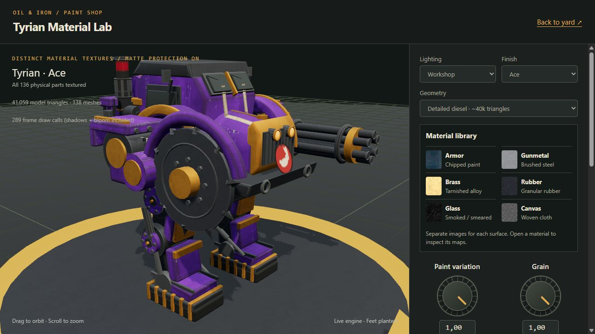
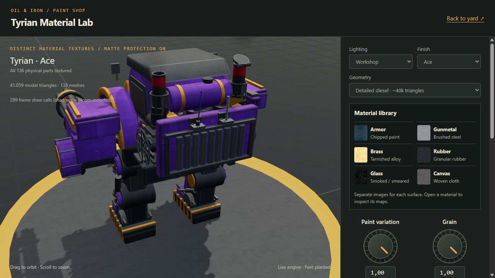

# Rig remodeling guide: Tyrian reference POC

Recorded **2026-10-20**, through implementation commit **`6573243`**. This is the reusable art and implementation record for bringing the rest of the roster up to the Tyrian POC standard. It records what exists, decisions made during review, and the work still needed before wider rollout.

Updated **2026-10-21** for the [Black detailed-model rollout](black-remodeling.md). Tyrian measurements below remain the original reference; Black's record contains its own geometry, validation and screenshots.

Tyrian is `light-saw-minigun`: a light chassis with Mini Gun and Circular Saw. Its [gameplay design](light-saw-minigun.md) remains separate. This work changes appearance, not weapon identity, rules, physical miniature base size, or tabletop adjudication.

Related records: [original rig/environment POC scope](../superpowers/specs/2026-10-20-remodel-poc-design.md) and [original implementation/validation log](../superpowers/plans/2026-10-20-remodel-poc.md). Environment remodeling is the second art track; this guide covers rigs and skins.

## 1. What is implemented, and where

| Layer | Current state | Rollout implication |
|---|---|---|
| Tyrian truck-walker body, weapon dressing, connected mechanics, five skins | Used by the normal remodeled rig | Reuse the construction approach, not its exact torso on every chassis |
| Diesel shake and exhaust smoke | In the remodeled rig; Tyrian shake tuned and approved | Give each new chassis its own reviewed tuning |
| Rear pennant/antenna attachment fix | Real armor mounts on remodeled rigs | Apply the same attachment discipline to every accessory |
| Tyrian and Black detailed geometry | Opt-in `detail: 'hero'`; material lab defaults to it | Normal gameplay still defaults to `detail: 'standard'` |
| Six image-based material families | Material lab only | Not yet installed as the shared gameplay material pipeline |
| Material controls and comparison | Live tool and exported standalone HTML | Use to review finishes before choosing defaults |
| Global anti-glare guards | Existing game safeguards retained | Never remove them to make new metal look shiny |
| Automatic distance LOD / device quality tiers | Not implemented | Requires a separate measured integration pass |
| Full-roster remodeling | Black and Tyrian have standard remodels and detailed material POCs; other chassis pending | Tracker in section 12 |

Three comparisons mean different things: `remodel: false` shows the legacy body; `detail: 'standard'` shows the lighter current remodeled body; the material lab's original-material comparison restores the materials on the selected geometry. Do not treat these as interchangeable baselines.

## 2. Art direction and rules to carry forward

**Grounded, rough dieselpunk tank walkers, with the personality and readability of a fun tabletop game.** References supplied by the maintainer: Warhammer Dreadnoughts, Into the Breach, Of Oil and Iron, old trucks, and old tanks. “Iron Reach” was corrected to **Into the Breach**.

- Give every chassis a distinct primary silhouette and vehicle ancestry. Tyrian is an old truck cab/bonnet on a walking frame; Black is a sloped tank casemate. Shared construction language must not become identical torsos.
- Build visible weight and support: broad feet, substantial joints, layered armor, frames, brackets, and credible weapon mounts. Avoid stacks of plain boxes.
- Use machinery with a legible purpose: fuel supply, cooling, exhaust, lubrication, suspension, and power transmission. Attach pipes and rods to something meaningful.
- Spend geometry on silhouettes, bevels, curves, recesses, and visible machinery. Use textures for fine grain, stains, and tiny scratches.
- Preserve readable faction/chassis color and weapon identity at gameplay distance. Weathering must not turn every rig into the same gray/brown shape.
- Treat skins as service histories, independent of current combat damage. Keep all five skins working through the remodeling pass.
- Every physical surface needs an intentional material family. UI rings, selection indicators, and other nonphysical overlays retain their own rendering.
- Broad, restrained reflections can explain rough metal. Chrome glare, white bloom blobs, and increased exposure are not the solution.
- Use original game-specific forms and details; the references establish direction, not a requirement to duplicate another game's model.

## 3. Tyrian anatomy: standard remodel and detailed POC



### Standard remodeled body

The old box-like torso became a recognizably truck-derived machine: exposed ladder frame, tapered bonnet, curved fenders, recessed radiator and grille, hood seam/latches/filler cap, split raked windscreen, cab roof, handles, and mirrors. Its mass sits on a lower walking chassis instead of a generic upright robot body.

The legs have broad soles and rubber pads, tread lugs, substantial thigh/knee/ankle pivots, and two hydraulic paths per leg. The rear engine carries three cylinders, radiator/fins, a strapped fuel tank, fuel plumbing, manifold and exhaust stacks. A side flywheel, connecting rod, slider, and hinged exhaust rain flap make its idle mechanically readable.

The original weapons remain identifiable and retain their animation contracts. Mini Gun dressing adds receiver/feed mass, an ammunition drum and barrel cage. Circular Saw dressing adds a gearbox, partial guard, and oil feed. Preserve their original spinning groups and firing origin.

### Detailed inspection geometry

The roughly 40k-triangle pass adds detail selectively:

| Assembly | Implemented detail |
|---|---|
| Cab and bonnet | Rounded eligible boxes, smoother bonnet profiles, windscreen wipers, hinged service panels, grab handles, hood latches, bumper-mounted tow eyes |
| Engine | Seven cooling fins on each of three cylinders, curved injector pipes, rocker/head covers and fasteners, oil filter, drain union, pressure/fuel hoses, manifold valve wheel |
| Cooling | Driven six-blade fan, shaft, fixed protective wire cage, mounting bars, rear radiator frame |
| Exhaust | Open stack mouths, inner walls and recessed dark floors, rims, slotted heat shields and clamp bands; skin collars do not cap the openings |
| Legs | Bearing covers, bolt circles and grease fittings on hip/knee pivots; arched flat leaf-spring packs attached to ankle assemblies |
| Mini Gun | Smoother barrels, muzzle rims with dark recess faces, correctly aligned ammunition-drum ribs, flexible service hose |
| Circular Saw | Smoother curved parts, scored rings and hub fasteners on both sides |

The exhaust mouths are genuinely hollow near their openings. Gun muzzle details are rims and dark recess faces, not fully modeled internal barrel bores. The valve wheel, wipers, hoses, doors, and spring packs are currently static details; the fan, crank, piston, flywheel, and exhaust flap animate.

Geometry settings in the reference implementation:

- Eligible boxes: rounded edges when largest dimension exceeds `0.12` and smallest is at least `0.035`; radius capped at `0.035` and 20% of each dimension. Tiny hardware stays economical.
- Existing round cylinders with at least eight sides: 24 sides, or 32 when radius exceeds `0.1`. Hexagonal bolt heads remain hexagonal.
- Refined tori: 10 tube segments, at least 32 around the ring. Extruded shapes: three bevel segments and 24 curve segments where applicable.
- Bonnet: additional longitudinal profiles and 32 half-arc steps, with creased normals. Smooth surfaces retain smooth normals through the material treatment; intentional armor edges stay defined.
- New detail uses its own smaller segment counts where appropriate. These are reference settings, not instructions to subdivide every primitive indiscriminately.



### Physical attachment and clearance fixes

The pennant and antenna previously floated behind the armor. `mountRearMast` now finds an actual hull/engine surface, creates a steel seat and bolted flange, and reparents the mast under its mounting assembly. The attachment moves with the armor during shake. Use the same principle for stowage, hoses, handles, and future accessories.

Additional review fixes: service panels and handle feet now reach the cab side; ammunition-drum ribs follow its Z axis; cooling-fan supports sit behind the rotor rather than intersecting its swept volume. Fan clearance was checked through 64 phases. The worn skin's bent stack pivots at its mount, not at its center. Paint/corrosion marks are projected onto the changed hull rather than left at old box coordinates.

Black's shield/body clipping was also corrected in the initial shared POC. Weapon-to-body and weapon-to-ground clearance remains a required check for every rig.

## 4. Diesel idle, mechanics, and smoke

The maintainer approved this **Tyrian** setting after using the shake tuner:

```json
{
  "chassis": "Tyrian",
  "shake": {
    "magnitude": 0.11,
    "frequency": 0.82
  }
}
```

These are multipliers, not meters and hertz. They apply to Tyrian across skins and survive the detailed-geometry pass. Do not replace them with an earlier, stronger experimental shake simply because the original brief asked for a rough diesel idle.

- Upper chassis shudders with a mix of combustion harmonics; the miniature base and planted feet do not rock in idle.
- Separate mechanical and vibration phases let the shake-frequency knob change vibration cadence without changing the crank/fan speed.
- Mechanical phase advances at `4 × (1 + heatFrac × 0.4)` radians/second, or `2 × (1 + heatFrac × 0.4)` when spent. Shake phase uses the frequency multiplier on that advance.
- Slider-crank geometry closes with a fixed rod length (`0.30`) and crank radius (`0.095`). Hydraulic barrels keep their length; rods extend with insertion overlap between actual moving anchors.
- The detailed fan follows the engine at `-3 × phase`. The hinged exhaust rain flap follows the engine pulse.
- Shutdown, broken engine, and destruction stop the engine motion at its current phase. They also suppress remodeled-engine exhaust. Resuming continues from the retained phase.
- Smoke comes from each actual stack mouth, including bent stacks, alternates outlets, and follows engine pulses. Emission is capped at **20 puffs/second per rig**; this is a rate limit, not a maximum live-particle count.
- Smoke uses the existing FX system. Machinery detail does not add one light per part. The material lab exposes a smoke toggle, enabled by default.

The shake lab supports chassis/skin selection, magnitude/frequency controls, pause, and JSON export. Reduced-motion preference pauses its animation initially. Tune other chassis individually; `.11/.82` is the approved Tyrian recipe, not a new global default.

## 5. All five skins are part of the model

| ID | Skin | Required character |
|---|---|---|
| `factory` | Factory Fresh | Coherent maintained paint, clean assembly, readable serials; still restrained metal response |
| `refit` | Field Refit | Faded paint, low mud, repairs, spare equipment, tarps/cans and purposeful stowage |
| `ace` | Ace | Strong color, cream/brass accents, nose art, tallies and pennant; personality through paint and kit |
| `worn` | Battle-Worn | Scorching, patch plates, a mount-preserving bent stack, damaged-service details and sparking cable |
| `rust` | Rust Bucket | Oxidation, primer patches, oil streaks and repair collars; readable material differences underneath |

Some older skin blurbs still say “glossy,” “polished,” or “chrome.” The newer anti-glare direction supersedes those words: Ace does not require mirror-like trim. Cosmetic wear must remain distinct from gameplay damage, heat, shutdown, and destroyed state.

Check all skins after body, weapon, and material changes. Cloned skin materials must retain material-family metadata. Preserve authored nose-art/stencil UVs; do not cover them with a generic steel image. Add-ons need real mounts, and repair collars must not accidentally seal exhaust bores.

## 6. Materials: separate surfaces, separate textures

The first procedural noise treatment looked like stone/cardboard rather than painted metal. Randomizing one steel texture across everything also failed the desired material distinction. The current lab uses **six independent image sets**, including fabric for the pennant and canvas accessories.

| Family | Source and maps | Intended reading |
|---|---|---|
| Armor | [Poly Haven Blue Metal Plate](https://polyhaven.com/a/blue_metal_plate), Rob Tuytel, 2K; diffuse, OpenGL normal, packed ARM | Chipped painted steel; preserve chassis paint color and distinguish exposed metal |
| Gunmetal | [ambientCG Metal009](https://ambientcg.com/a/Metal009), 1K; color, normal, roughness, metalness | Dark brushed/machined steel for weapons and mechanical parts |
| Brass | [ambientCG Metal048C](https://ambientcg.com/a/Metal048C), 1K; color, normal, roughness, metalness | Tarnished alloy; source is a gold-alloy scan tinted to brass |
| Rubber | [ambientCG Rubber004](https://ambientcg.com/a/Rubber004), 1K; color, normal, roughness | Granular dark rubber on pads, grips and suitable hoses |
| Glass | [ambientCG Smear002](https://ambientcg.com/a/Smear002), 1K; color, normal, roughness | Smear contamination over smoked dielectric glass; not a metallic-glass scan |
| Fabric | [ambientCG Fabric030](https://ambientcg.com/a/Fabric030), 1K; color, normal, roughness | Woven cloth on pennants and canvas |

These 20 unique JPGs and their `LICENSE.txt` records are stored under [the material asset directory](../../client3d/src/assets/materials). Each set has CC0 attribution/source/hash records. Preserve those records when replacing or adding assets.

Color maps use sRGB; normals, roughness and metalness use no color-space conversion. Normals are OpenGL convention. The armor ARM image packs AO in R, roughness in G, metalness in B; the treatment reads the relevant roughness/metalness channels. Textures repeat and use anisotropy capped at `min(8, hardware maximum)`. Loads are cached by URL and maps are shared.

### Family assignment and full coverage

`surfaceMat(family, color, options)` records `material.userData.materialFamily`; skin and matte clones preserve it. Assign families semantically, not by guessing that every yellow part is brass or every dark part is metal. Cockpit/lamp identities receive glass treatment. Untagged accessory fallbacks exist, but new parts should carry explicit tags.

The study traverses **every physical MeshStandardMaterial** in the rig, including weapons, accessories, material arrays, and skin clones. Previously overlooked barrels and cockpit panes now receive their own finishes. Selection/team markers remain nonphysical overlays. Authored decal maps/UVs are preserved.

The cockpit uses dark smoked glazing with only 2% of its original emission, avoiding the former blank pale rectangles. Lamp and vent state colors/emission remain responsive. Rubber, cloth and glass do not inherit armor's exposed-steel chip treatment.

### Surface mapping, wear, and controls

- Project texture coordinates in the rig's rest frame, including shapes without authored UVs. Surfaces keep their textures while moving.
- Maintain physical texture density per family. Connected shells get deterministic layout variation; individual triangles do not get random textures.
- Blend shifted samples to reduce recognizable tiling, keeping color/normal/roughness/metalness aligned. This supplements distinct family sources; it does not replace them.
- Compute wear from actual panel boundaries and creases (22° threshold), ignoring internal coplanar triangulation. Keep smooth source normals intact.
- Keep paint variation, microrelief, edge wear, and grime separately adjustable. Grime uses surface staining and lower-body weighting; wear should explain handling and exposure.
- Clone study geometry/materials rather than mutating the game's shared cache. Comparison and disposal restore the originals.

Current family starting values in `material-study.js`:

| Family | Roughness baseline | Metalness baseline | Normal strength before grain multiplier | Texture density |
|---|---:|---:|---:|---:|
| Armor | 0.75 | 0 | 1.10 | 2 |
| Gunmetal | 0.70 | 0.92 | 0.50 | 3.5 |
| Brass | 0.70 | 0.90 | 0.38 | 3 |
| Rubber | 0.96 | 0 | 0.65 | 6 |
| Glass | 0.70 | 0 | 0.05 | 1.2 |
| Fabric | 0.98 | 0 | 0.45 | 5 |

Density is projected tiles per rig-space unit before stable layout variation. These are shader starting values, not constant final per-pixel values: maps, dirt, and exposed-metal chips modify them subject to the safeguards below.

Current code defaults, with each control clamped to `[0, 1]`:

```json
{
  "paintVariation": 0.85,
  "grain": 0.55,
  "edgeWear": 0.35,
  "grime": 0.30
}
```

The lab stores tuning per chassis and skin. Tyrian retains `oil-iron-material-lab-pbr-v1`; Black uses `oil-iron-material-lab-pbr-v1-Black`. A previously viewed Tyrian Ace preview used `1 / 1 / 1 / 0`; that observed local recipe is **not** an explicitly approved global default. Record final material approvals separately, just as the shake approval was recorded.

## 7. Anti-glare contract

| Guard or review setting | Value | Scope |
|---|---:|---|
| Minimum shader roughness | `0.70` | Global standard/physical surfaces |
| Local point/spot light peak cap | `4` | Per-light, per-pixel RGB peak; hue preserved |
| Reflected-light peak cap | `1.6` | Material study; emission handled separately |
| Bloom threshold | `2.2` | Existing post-processing |
| Lab ACES exposure | `1.15` | Reference preview |
| Lab reflection environment intensity | `1` | Broad, dim workshop reflection panels |
| Lab directional / hemisphere intensity | `2.2 / 0.65` | Reference preview |
| Glare stress lamp | Intensity `120`, distance `6`, decay `2` | Deliberate close-light stress mode |

Retain roughness and light guards when integrating the materials into gameplay. Do not lower them to make gunmetal/brass appear metallic. Use their distinct base response, texture, normals and broad reflections. The material-study cap preserves intentionally emissive lamps/hot vents rather than suppressing every glow.

Review all angles in Workshop, Foundry Dusk and Glare Check. Also use the actual game themes (Foundry Dusk, Rail Yard, Refinery Night), close-up and tabletop distance. Approval means the shape and material remain readable without reflected white blobs blooming into the camera.

## 8. Performance record and geometry budget

Recorded in the browser for **Tyrian Ace**, on the same material-lab setup:

| Geometry | Model triangles | Meshes | Observed full-frame draw calls |
|---|---:|---:|---:|
| Standard remodeled POC | 12,015 | 141 | 294 |
| Detailed inspection POC | 41,059 | 138 | 289 |

The “40k” request is implemented as roughly 41k, not a hard 40,000 ceiling. Headless tests allow **35k–45k triangles and at most 140 meshes** across the five detailed skins; the standard model stays below 14k. Browser-generated marks can account for small differences from headless counts.

Model triangles count visible model geometry once. Frame draw calls include shadows and post-processing; they are not just the mesh count and can vary with camera, skin, and smoke. These observations are **not a controlled GPU/FPS benchmark** and do not prove that fourteen detailed rigs plus terrain will run at a given frame rate.

The added geometry avoided a draw-call explosion by merging fixed detail with matching material/part inside the same moving assembly. Never merge across articulated parents. Keep stacks, hydraulic rod/sleeve references, accessory pivots, meshes with children, surface marks and mapped decals intact. Preserve damage-location grouping and animated weapon roots.

The lab also caps DPR at 2, uses one 1024 shadow map, and retains the existing HDR/MSAA/bloom path. Texture memory, shader sampling, shadow rendering and smoke overdraw matter alongside triangle count. The current JPG texture library is a POC asset package, not a completed memory/compression optimization.

Planning ranges for later rollout, **not implemented LOD settings or performance promises**:

| Use | Initial budget to investigate |
|---|---|
| Inspection / garage close-up | 35k–50k triangles per rig |
| Normal battlefield view | 12k–20k triangles per rig |
| Far view | 4k–8k triangles per rig |

Before promoting hero detail into gameplay, measure a populated battle with terrain, all visible effects, shadows and post-processing on the target hardware. Record resolution/DPR, GPU/device, visible rigs, camera, theme, draw calls and frame times. If targeting 60 FPS, the **whole scene** has 16.7 ms; no per-rig budget alone guarantees that result.

## 9. Implementation map and contracts

| File | Responsibility |
|---|---|
| [mechs.js](../../client3d/src/scene/mechs.js) | Main construction, detail selection, weapon/skin integration, state updates and exhaust emission |
| [tank-walker.js](../../client3d/src/scene/rig/tank-walker.js) | Black/Tyrian standard bodies, mechanics, approved shake, weapon dressing, conforming skin marks and matte finishing |
| [detail-kit.js](../../client3d/src/scene/rig/detail-kit.js) | Shared selective refinement, geometry helpers, hollow exhausts and safe batching |
| [tyrian-detail.js](../../client3d/src/scene/rig/tyrian-detail.js) | Detailed Tyrian machinery and weapons |
| [black-detail.js](../../client3d/src/scene/rig/black-detail.js) | Detailed Black armor fittings, machinery, cannon and shield |
| [kit.js](../../client3d/src/scene/rig/kit.js) | Shared geometry/material helpers and semantic family tags |
| [skins.js](../../client3d/src/scene/rig/skins.js) / [wear.js](../../client3d/src/scene/rig/wear.js) | Five skins, attachments, markings, damage dressing and rear mast mounts |
| [material-study.js](../../client3d/src/scene/rig/material-study.js) | Lab-only family treatment, projected UVs, wear, controls and reversible replacement |
| [material-textures.js](../../client3d/src/tools/material-textures.js) | Source library and texture loading |
| [matte.js](../../client3d/src/scene/matte.js) / [post.js](../../client3d/src/scene/post.js) | Global glare safeguards and post-processing |
| [envelope.js](../../client3d/src/scene/rig/envelope.js) | Body/base size validation |
| [material-tuner.js](../../client3d/src/tools/material-tuner.js) / [shake-tuner.js](../../client3d/src/tools/shake-tuner.js) | Review tools, exportable settings and runtime readouts |

Construction order matters: build body/materials → apply skin → attach weapons → lamps/stencils → dress weapons → conform skin marks → finish/compact materials → tag locations. The lab applies its reversible material study to the completed rig.

Coordinates are **+X forward, Y up, Z width** in the builder. Preserve the `pelvis`, `torso`, `legs`, arm, socket, stack and mechanics references, plus weapon `spin` groups and muzzle origin. Tyrian's `baseScale` is `0.48`; its light base radius stays `1.18`. Its remodeled body envelope is height `1.52`, radius `0.75` in root space after scaling, with weapons excluded. Check weapon sweeps separately. Other chassis need deliberate envelope decisions, not blind reuse of Tyrian dimensions.

`detail: 'hero'` currently applies to Tyrian and Black. It is not a generic switch that gives every existing rig this treatment.

## 10. Open, compare, export, and validate

With the local dev server running:

- [Material lab](http://localhost:5174/3d/src/tools/material-tuner.html): Black/Tyrian selection, detailed/standard geometry, five skins, four finish controls, lighting, smoke, comparison and cost readouts. [Open Black directly](http://localhost:5174/3d/src/tools/material-tuner.html?chassis=Black).
- [Shake lab](http://localhost:5174/3d/src/tools/shake-tuner.html): magnitude/frequency tuning and JSON export.
- [POC yard](http://localhost:5174/3d/#dev=poc.scene): rig/environment context and legacy comparison.
- [Tyrian Ace POC](http://localhost:5174/3d/#dev=poc.Tyrian.ace): current standard remodeled rig in the POC viewer; not the lab's hero/material treatment.

Standalone deliverables produced during the work: `tyrian-material-lab.html`, `black-material-lab.html` and `diesel-shake-lab.html`. Their local copies live in `C:/Users/breke/.codex/visualizations/2026/10/20/01a15a37-956d-70b2-9614-5cae10ae0ecf/`. Regenerate them after source changes; an already open file tab needs reloading. The material export embeds its JS and texture assets. Newly generated material exports include both supported chassis; the optional final argument chooses the starting chassis.

Relevant commands from repository root:

```powershell
node --test --test-reporter=dot "client3d/**/*.test.js"
node node_modules/vite/bin/vite.js build --config client3d/vite.config.js
node client3d/src/tools/export-material-tuner.mjs "<absolute-output-path>/tyrian-material-lab.html"
node client3d/src/tools/export-material-tuner.mjs "<absolute-output-path>/black-material-lab.html" Black
node client3d/src/tools/export-shake-tuner.mjs "<absolute-output-path>/diesel-shake-lab.html"
```

Broader regression checks used during implementation:

```powershell
node --test "shared/**/*.test.js" "server/**/*.test.js" "scripts/**/*.test.mjs"
npx vitest run
```

Implementation validation snapshot at `6573243`: **135 3D tests passed**, 3D build passed, shared/server/script tests passed. Broader Vitest reported **318 passed / 1 failed**: V2 `client/src/v2/components/LoadoutView.test.tsx:32` still expected “Depleted Core” after the shared catalog renamed it “Tungsten Core.” The upgrade ID and effect were unchanged. This failure was naming fallout from the shared change; the V2 test file was outside this task and unchanged. This is a historical snapshot, not a claim that documentation edits reran those suites.

Focused coverage lives in [tank-walker.test.js](../../client3d/src/scene/rig/tank-walker.test.js), [tyrian-detail.test.js](../../client3d/src/scene/rig/tyrian-detail.test.js), and [material-study.test.js](../../client3d/src/scene/rig/material-study.test.js). It checks mechanic closure/anchors, idle tuning, stop/resume, smoke outlets, skin/envelope behavior, triangle/mesh bounds, material coverage, smooth normals and reversible material comparison. Browser review checked front/rear, geometry switching, all five skins, Workshop/glare modes and console errors. Full populated-battle performance remains unmeasured for hero geometry plus the new texture treatment.

## 11. Repeatable checklist for the next rig

1. **Capture the baseline.** Record chassis ID, weapons, five skins, existing dimensions, screenshots, triangles/meshes and frame draws. State whether the work targets normal gameplay, inspection, or both.
2. **Choose its identity.** Write one vehicle reference and one silhouette sentence. Contrast it with already remodeled rigs; do not give every rig Tyrian's cab. Preserve distinctive weapon shapes and game readability.
3. **Build the supporting structure.** Model frame, weight-bearing joints and feet first, then shaped armor and weapon mounts. Check envelope/base and weapon sweeps before detail obscures problems.
4. **Add meaningful machinery.** Lay out fuel → engine → cooling/exhaust and power → joints/weapons. Add service panels, fasteners, hoses, filters, bearings and guards where they explain construction. Use bevels/curves at visible edges.
5. **Connect motion correctly.** Put geometry under its true moving parent. Test fixed-length rods, hydraulic insertion, planted idle feet and engine stop/resume before layering on decoration. No cosmetic hose/rod should float through the movement range.
6. **Integrate all skins.** Project markings to the actual hull; attach stowage/pennants/antennae with brackets; preserve bend pivots and open exhausts. Keep combat damage independent of cosmetic history.
7. **Assign all material families.** Cover armor, gunmetal, brass, rubber, glass and fabric wherever present, including weapons and accessories. Preserve decals and dynamic lamps. Inspect coverage, texture scale, normals and repetition closely.
8. **Tune and record.** Review paint variation, grain, edge wear and grime; choose idle magnitude/frequency for that chassis. Save approved JSON separately from code defaults and temporary local-storage values.
9. **Control cost.** Merge fixed parts by moving parent/material/location. Record standard and detailed counts for every skin; retain lighter geometry until actual battle profiling supports promotion.
10. **Validate in motion and light.** Orbit front/rear/sides/top/low angles. Exercise idle, walking, aiming, recoil, melee, heat, spent, broken engine, shutdown and destroyed state. Check blade/guard/body/ground clearance, fan sweeps, smoke origins, mounts, glare and tabletop readability.
11. **Test the real invariants.** Use tests for geometry budgets, finite vertices, mechanics math, attachment endpoints, bounds, material coverage and state transitions. Visual dressing alone does not need implementation-mirroring tests. Run 3D tests/build and inspect the live browser console.
12. **Deliver a reproducible record.** Save front/rear screenshots, approved tuning, measured cost, remaining limitations and source pointers. Update this tracker and exported lab. Keep edits in the shared main checkout, preserve unrelated work, and commit the task once.

Acceptance gate: distinctive silhouette; believable connected machinery; no floating physical parts; all five skins; all physical surfaces intentionally finished; approved idle; no new glare; correct status behavior; stable base/weapon contracts; measured cost and explicit gameplay-vs-lab scope. A close-up screenshot alone is insufficient.

Suggested per-rig record to fill in:

```text
Chassis / ID / weapons:
Vehicle ancestry and silhouette:
Scope: standard gameplay / detailed inspection / material lab
Body, machinery, weapon and skin changes:
Material sources and family exceptions:
Approved shake JSON / approved material JSON:
Standard vs detailed triangles, meshes, draws; device and scene:
Envelope and moving-part clearance checks:
Tests/build/browser results; screenshots:
Remaining work and implementation commit:
```

## 12. Roster rollout tracker

All fourteen chassis already have existing model recipes and skins. “Pending” means pending this remodeling standard, not missing models. Tyrian's material/hero work is the reference; Black now has its own detailed/material pass following that guide. Do not interpret a similarly named chassis as a material or skin family.

| Chassis | ID | Remodeling status |
|---|---|---|
| Gold | `light-claw-autocannon` | Pending |
| Cobalt | `light-missile-flamethrower` | Pending |
| Tyrian | `light-saw-minigun` | Standard remodel in game; detailed geometry + six-family material lab complete; gameplay material/LOD promotion pending |
| Rust | `light-wreckingball-double` | Pending |
| Dazzle | `light-sword-arc` | Pending |
| Turquoise | `light-harpoon-anchor` | Pending |
| Verdigris | `light-rivet-pressureclaw` | Pending |
| Copper | `medium-lance-mortar` | Pending |
| Black | `medium-shield-siege` | Standard remodel in game; [detailed geometry + six-family material lab complete](black-remodeling.md); gameplay material/LOD promotion pending |
| Red | `medium-sniper-chainsaw` | Pending |
| Silver | `medium-crossbow-talon` | Pending |
| Brass | `medium-steam-piston` | Pending |
| Ivory | `medium-flare-bayonet` | Pending |
| Jade | `medium-tesla-shockglove` | Pending |

Remaining shared work: choose and record final finish recipes; integrate the family materials into gameplay with appropriate loading/caching; profile populated battles; decide quality/LOD policy; extend the tools beyond Black and Tyrian; then remodel the roster while preserving unique silhouettes. Walkers/drones and the remaining environment catalog need their own scoped passes.

## 13. Iteration history and lessons

| Commit | Work / lesson retained |
|---|---|
| `90a63c6` | Initial Black/Tyrian and industrial-yard POC: grounded walker structure, distinct tank/truck torsos, skins, mechanics and smoke |
| `4a46ed2` | Portable shake tuner: judge motion interactively rather than guessing constants |
| `cf109af` | Apply the approved Tyrian shake recipe `.11 / .82` |
| `c9b39a8` | First material tuner: controls useful, procedural noise alone did not read as metal |
| `c25753b` | Move to real image-based PBR surface maps |
| `50d49b3` | Cover every physical material, including skin clones/accessories |
| `7e6b3bf` | Correct weapon metal and smoked cab glass; material identity matters |
| `20a10e4` | Reduce visible repetition with stable surface layout/sample variation |
| `89ce152` | Give each material family its own source texture set; randomizing one texture was insufficient |
| `9395f75` | Mount rear pennant and antenna to real armor instead of leaving floating shapes |
| `6573243` | Detailed Tyrian inspection model: smoother shapes, meaningful machinery, safe batching, live counts and geometry comparison |

The reusable result is a construction/material/validation method. Apply it to each rig's own identity, rather than copying Tyrian's truck body or merely increasing polygon counts.
